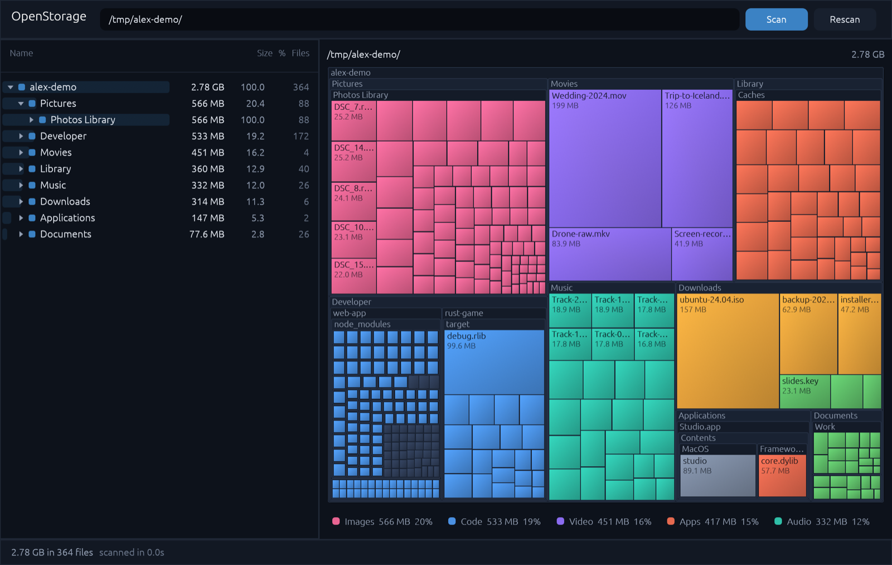

<p align="center">
  
</p>

<h1 align="center">OpenStorage</h1>

<p align="center">
  <b>See what is eating your disk.</b><br>
  A tiny, fast, free disk usage visualizer: a sortable tree and a treemap of every file.<br>
  100% Rust and egui, for macOS, Windows and Linux.
</p>

<p align="center">
  
  
  
  
</p>

<p align="center">
  <a href="https://openstorage.mdnlabs.dev/download"><b>Download</b></a> ·
  <a href="https://openstorage.mdnlabs.dev">Website</a> ·
  <a href="https://github.com/MarshallNickolauson/OpenStorage/releases">Releases</a>
</p>



## What it does

Point OpenStorage at a folder or a whole drive. It walks the disk on every core, then shows you:

- **A tree** of folders and files sorted by size, with a percentage bar and a file count on every row.
- **A treemap** where each rectangle is a file and its area is its size. Folders nest inside folders, so one glance tells you where the space went.
- **A color-coded legend** (images, video, audio, archives, code, documents, apps, other). Click a type to light up where those files live.

The tree and the map are linked: click a tile to jump to it in the tree, or a row to outline it on the map.

## Using it

| Do this | To get this |
| --- | --- |
| Pick a quick location, type a path, or drop a folder on the window | Start a scan |
| Hover a tile | Name, full path, size, share of the scan |
| Click a tile or row | Select it (tree and map stay in sync) |
| Double-click a **folder** tile | Zoom the map into it |
| Double-click a **file** (tile or row) | Reveal it in Finder / Explorer / your file manager |
| Right-click a row | Show in map, reveal, copy path |
| Breadcrumbs or <kbd>Backspace</kbd> | Zoom back out |
| `openstorage <path>` | Start scanning immediately from the command line |

OpenStorage is **read-only**: it never deletes, moves or uploads anything. Symlinks and virtual file systems (`/proc`, `/sys`, firmlinked duplicates on macOS) are skipped so nothing is counted twice. Sizes are disk usage (allocated blocks) on macOS and Linux and file length on Windows.

## Install

Grab a build from the [releases page](https://github.com/MarshallNickolauson/OpenStorage/releases):

- **macOS**: `.dmg` (Apple silicon and Intel). Unsigned, so right-click → Open the first time.
- **Windows**: a single portable `.exe`. SmartScreen may warn because it is unsigned.
- **Linux**: a `.tar.gz` with one binary. Needs X11 or Wayland and a working OpenGL driver.

### Build from source

You need [Rust](https://rustup.rs) 1.85 or newer. No other toolchain is required.

```bash
git clone https://github.com/MarshallNickolauson/OpenStorage.git
cd OpenStorage
cargo run --release
```

On Linux the usual windowing libraries are needed (for Debian/Ubuntu: `libxkbcommon-dev libwayland-dev libx11-dev libgl1-mesa-dev`).

## How it is built

Small on purpose: four source files, three direct dependencies, one binary of a few megabytes.

| File | Job |
| --- | --- |
| [`src/scan.rs`](src/scan.rs) | Parallel directory walk ([rayon](https://github.com/rayon-rs/rayon)) into a compact arena tree, plus per-type totals |
| [`src/treemap.rs`](src/treemap.rs) | [Squarified treemap](https://www.win.tue.nl/~vanwijk/stm.pdf) layout with nested folder frames |
| [`src/main.rs`](src/main.rs) | The egui app: tree, map, legend, scan progress |
| [`scripts/make-icon.py`](scripts/make-icon.py) | Generates the logo (SVG and PNG) from one shared geometry |

The UI is [egui](https://github.com/emilk/egui) through `eframe` with the `glow` backend, so there is no web view and no runtime. Releases are built by [GitHub Actions](.github/workflows/release.yml) for all three platforms when a `v*` tag is pushed.

### Website

The site in [`website/`](website) is plain static HTML, CSS and a little JavaScript (no build step), including an interactive treemap demo. Preview it with `cd website && python3 -m http.server 8080`, deploy with `npx wrangler pages deploy website --project-name openstorage`.

## Not affiliated

OpenStorage is an independent project inspired by the idea behind tools like WinDirStat and WizTree. It contains no code or assets from them.

## License

[MIT](LICENSE) © 2026 Marshall Nickolauson. Part of [mdnlabs](https://mdnlabs.dev).
